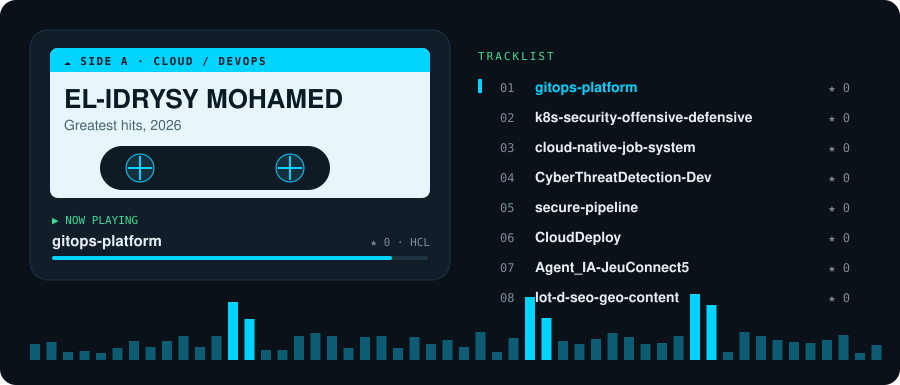
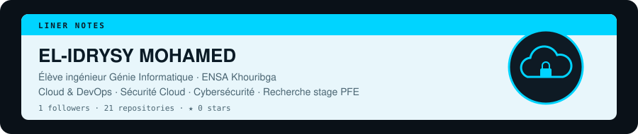
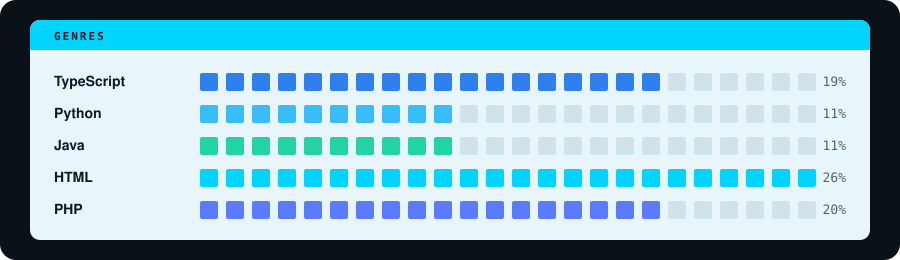

  

  <a href="https://github.com/elidsimo/gitops-platform">gitops-platform</a> ·
  <a href="https://github.com/elidsimo/k8s-security-offensive-defensive">k8s-security</a> ·
  <a href="https://github.com/elidsimo/cloud-native-job-system">cloud-native-job-system</a> ·
  <a href="https://github.com/elidsimo/CyberThreatDetection-Dev">CyberThreatDetection-Dev</a> ·
  <a href="https://github.com/elidsimo/Agent_IA-JeuConnect5">Agent_IA-JeuConnect5</a> ·
  <a href="https://github.com/elidsimo/lot-d-seo-geo-content">lot-d-seo-geo-content</a>

---

## 🧭 À propos de moi

- 🎓 Dernière année du **Cycle Ingénieur Génie Informatique** à l'**ENSA Khouribga** — option *Sécurité, Cloud & Ingénierie Logicielle*
- 🎯 **À la recherche d'un stage PFE** en **Cloud / DevOps / Platform Engineering**
- 🔐 Passionné par la **sécurité Cloud**, le **DevSecOps** et la **cybersécurité**
- 🌍 Arabe (maternel) · Français (courant) · Anglais (courant)

## 🛠️ Stack

  
  
  
  
  
  
  
  
  
  
  
  
  
  

## 📫 Me contacter

  
  

